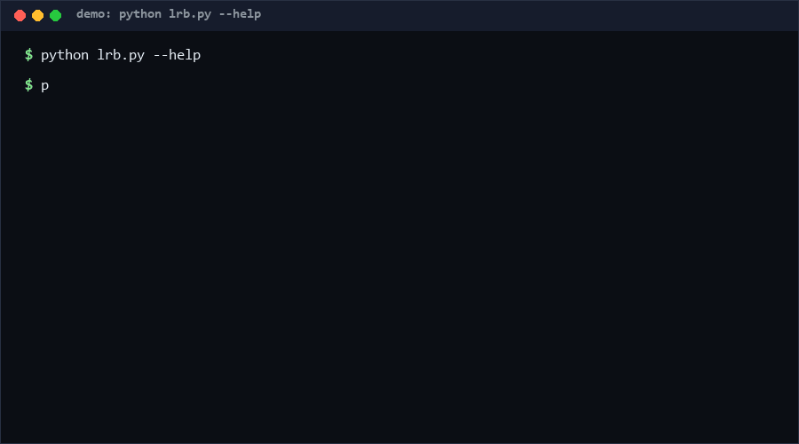

# lossless-roundtrip-bench

A roundtrip fidelity benchmark for document codecs, generic edition. Read → mutate → save → re-read → diff: does a harmless edit survive a save exactly? Text codecs get byte identity; JSON gets deep key/value identity plus a double-save instability check. A deliberately lossy demo codec proves detection fires. If you promise "lossless editing", benchmark it here; if you need format-specific fuzzing (OOXML/VBA), that is another tool.

**As of 2026-10-11.**

<p align="center"></p>

## Problem

"Lossless" is the most claimed and least measured word in document tooling. Editors and converters silently drop what they cannot represent: unknown keys, float precision, key order, trailing bytes. Marketing says compatible; users find out when their file comes back different. The industry debt is that compatibility is never a *number*.

This repo makes the roundtrip a benchmark: one harmless mutation, one save, one reload, one diff. The diff is structural (lost / changed / added paths), not a blob hash — so a report says *what* was lost, not just that something was.

## How it works

A codec registers three functions (`load`, `save`, `mutate`). The benchmark then runs:

1. `doc1 = load(raw)` — the original document.
2. `doc2 = mutate(doc1)` — a deterministic, reversible probe (JSON: add `_lrb_probe`; text: prepend a marker line).
3. `saved = save(doc2)`, then `reloaded = load(saved)` — the roundtrip.
4. `deep_diff(doc2, reloaded)` — walks dicts/lists/scalars, emitting `lost` (key present before, absent after), `changed` (value differs), `added` (probe itself is expected and filtered out of the verdict).
5. Double-save instability: `save(load(save(doc2)))` must equal the first save — catches non-idempotent serializers that drift on every save.

Verdict is `LOSSLESS` (zero unexpected diffs, score 100%) or `LOSSY` (with counted, path-addressed diffs). Exit code 1 under `--strict` makes it a CI gate.

## Quickstart

```bash
# ~5 s: see the codecs
python lrb.py codecs

# ~5 s: benchmark a JSON file (exit 0 = LOSSLESS)
python lrb.py bench --codec json report.json

# ~5 s: prove detection works (exit 1 with --strict)
python lrb.py bench --codec lossy-demo report.json --strict

# ~5 s: self-test (17 cases)
python self_test.py
```

Machine-readable: add `--json`. Suite includes a >1 MiB nested JSON corpus: LOSSLESS, measured locally (repro: the `edge/huge-json-1mib-lossless` case in `self_test.py`).

## Why not X

| Alternative | Why not alone |
|---|---|
| Byte-hash before/after | A hash says "different", never *what* differs; formatting churn masks real loss and vice versa |
| `git diff` on exported text | Line-diff heuristics; no structural lost-key semantics; no double-save instability concept |
| Format-specific suites (OOXML validators, Office interop labs) | Deep but enormous; the generic roundtrip core here runs in 5 s with zero dependencies and ports to any codec |
| Property-based fuzzers (Hypothesis) | Excellent for finding codec bugs, but not a *scored benchmark* with a stable mutation contract you can print in a README |

## Minimal Fallback

No Python? The core loop is three commands: copy the file, apply your edit, `diff <(jq -S . a.json) <(jq -S . b.json)` — sorted-key diff approximates the structural check for JSON. You lose the double-save instability check, counted scores, and the exit-code CI gate, but the "did my edit survive the save" question stays answerable.

## Design Trade-offs

Priority order when goals conflict: **explicit loss over silent loss > portability > depth > speed**.

- Structural diff over byte hash: more work, but actionable output; the byte path remains for text codecs.
- One deterministic probe mutation, not random fuzzing: reproducibility and a stable benchmark number beat marginal coverage.
- Deep-diff in pure Python: slow for huge files vs. a C diff, fine for benchmark-sized corpora (~1 MiB runs in seconds, stdlib only).
- Score is binary-favoring (100% or counted losses): no fake 99.2% comfort; either nothing was lost or here is the list.
- `lossy-demo` ships in the box: keeping the negative control visible prevents "green bench = working detector" self-deception.

## Limits & Second-order Effects

- **Limits.** v0.1 is text/JSON only — no binary formats, no OOXML/zip internals, no styling metadata; the mutation vocabulary is one probe per codec (not an edit suite); normalized JSON comparison ignores key order by design, so order-loss is invisible to the json codec (documented, deliberate); performance numbers are local-machine measurements, not a published corpus.
- **Second-order effects.** A visible lossless score invites gaming: codecs can special-case the probe mutation, which is why the probe is trivially re-implementable and reviewers should run their own mutations. Benchmarks also bias designs toward diffable serialization (sorted keys, no floats) — real documents need both. And green CI badges become trust theater if nobody reads whether the corpus resembles their files.

## FAQ

**Q: Is this only for JSON and text?** v0.1, yes — deliberately. The codec interface (load/save/mutate) is the point; OOXML/VBA/zip codecs plug in the same way and are out of scope here.

**Q: What is "double-save instability"?** Serializers that change output on every save (timestamp injection, order rotation) — the file is never "done". Detected by saving twice and diffing.

**Q: Why add a probe key before saving?** The edit proves the roundtrip happens through the *edited* document, not a cached original; it also verifies the save path executes at all.

**Q: Can I benchmark my own codec?** Register a dict in `CODECS` with `load`/`save`/`mutate` and the benchmark runs unchanged.

**Q: When NOT to use this?** (Socratic check) Not as a compatibility *certification* (one probe is not a corpus), not for binary formats in v0.1, not as a fuzzer (it never searches for weird inputs), and not as proof of byte-perfection for JSON (order is ignored by design).

## Core Assumptions

- [A1] Structural loss (keys/values) is what users actually fear more than byte-level formatting churn. *(High confidence — byte churn is invisible, lost keys are not.)*
- [A2] A deterministic single-probe mutation yields a stable, meaningful benchmark number. *(Medium confidence — gameable in theory; see second-order effects.)*
- [A3] Double-save idempotency is a necessary condition for a trustworthy "save" operation. *(High confidence.)*
- [A4] ~1 MiB nested JSON is a representative benchmark scale for this tool class. *(Medium confidence — [estimated] from local task files, no cross-tool corpus study.)*

*Measured marker: self-test 17/17 PASS (repro `python self_test.py`); 1 MiB nested-JSON roundtrip LOSSLESS on the dev machine (Windows 10, CPython 3.13). Knowledge cutoff: 2026-10-11.*
